<div align="center">

<picture>
  <source media="(prefers-color-scheme: dark)" srcset="docs/brand/uncovered-logo-on-dark.png">
  
</picture>

**Records worth uncovering.**

Buying vinyl online means guessing: which new pressing is worth it, whether a used copy is clean, and which turntable you actually need.<br>
Uncovered is a record shop that does the digging for you: real releases, hand-graded used vinyl, and turntables explained in plain words.

<a href="https://uncovered-store.netlify.app"></a>

<sub>Browse, listen to 30-second extracts, build a pack and fill your cart for real. Checkout stops before payment, so no money moves.</sub>

[See the opening](#the-opening) · [See every screen](#every-screen) · [The one idea](#the-one-idea) · [The marketing work](#the-marketing-work) · [How we'd measure it](#how-wed-measure-it) · [For engineers](#for-engineers)

<a href="https://uncovered-store.netlify.app">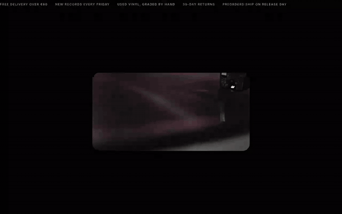</a>

<sub>The first 15 seconds on the site. Click it to try it yourself.</sub>

</div>

## At a glance

| | |
|---|---|
| **The problem** | Vinyl buyers hesitate at the same moments: too many releases to choose from, no way to trust a used record's condition, and confusion about turntables, speakers and preamps. |
| **What we did** | Wrote the blueprint and page copy, then built a one-page shop that answers each hesitation where it comes up. It's stocked with a real catalogue and paired with an SEO and netlinking plan. |
| **Skills** | Brand positioning · information architecture · copywriting · merchandising · pricing and bundles · conversion design · content and video · SEO · netlinking · measurement planning |
| **See it** | [Live store](https://uncovered-store.netlify.app) · [SEO plan](docs/SEO-PLAN.md) · [Netlinking partners](docs/NETLINKING.md) · [Every screen](#every-screen) |

## The problem we saw

People who want to buy records online drop off long before checkout. We mapped where they hesitate, and it came down to four doubts:

- **"What's actually worth buying?"** Dozens of records come out every Friday. Without someone choosing, a beginner doesn't know where to start and a collector misses the limited pressings.
- **"Is this used copy any good?"** Second-hand vinyl is the best value in music, but a vague "good condition" listing is a gamble. One bad scratch and the buyer never comes back.
- **"Which turntable do I need, and do I need speakers?"** First-time buyers stall on preamps, belts and speakers, and leave to search elsewhere.
- **"Will I miss it?"** Preorders and short runs sell out, and nobody tells you in time.

None of these is a dealbreaker on its own. Together, they turn a fun purchase into homework.

## The one idea

> **We dig through the crates so you don't have to.**

Every part of the page does part of the digging for the visitor:

- **We choose.** A *Current Reco* each month, a *Release of the week*, and ranked best-sellers (#1, #2, #3) instead of an endless grid.
- **We check.** Every used record carries two grades, one for the record and one for the sleeve, on the standard scale (NM, VG+, VG, G).
- **We bundle.** The *Pack Offer* turns the hardest decision (which turntable?) into one step: pick a deck and three records, and 10% comes off.
- **We tell you first.** A Friday release-alert email, so nobody misses a preorder.

## The opening

The first seconds sell the feeling before the product, in three beats on black:

1. **A window.** The page opens on a small rounded window of turntable footage.
2. **The room.** The window expands to full screen, then the header and a frosted glass panel fade in: *"Records worth uncovering."* with **Build my pack** and **Shop last releases**.
3. **The popup.** A card opens over the blurred hero. Its stage runs like a record finder (*Uncover your vinyl.* → *Your record.* → *Hounds of Love* → *Moon Safari* → *Graded.* → *Flip.*), and each record plays **its official video** behind it. Below the stage: *"We dug through everything. And that uncovers everything."* with **Try it now** and **Maybe later**.

| Scene | Record | Background video |
|---|---|---|
| Your record · Hounds of Love | Kate Bush, *Hounds of Love* | *Running Up That Hill*, official |
| Moon Safari | Air, *Moon Safari* | *Sexy Boy*, official |
| Graded. | Talking Heads, *Remain in Light* | *Once in a Lifetime*, official |
| Flip. | David Bowie, *Hunky Dory* | *Life On Mars?*, official |

## How the journey works now

1. **Land.** The opening above, plus a scrolling bar that answers the practical questions straight away: free delivery over €60, new records every Friday, used vinyl graded by hand, 30-day returns.
2. **Get a point of view.** Three panels: **Our concept** (what we do), **Current Reco** (*Kind of Blue*, with a 30-second listen) and **Pack Offer**.
3. **Pick a door.** The main menu (What's new · Preorder · Vinyl · Record players · Special sales) shows each category's one-line intro on hover, then filters the shop grid.
4. **See what's new.** *Last releases* are real September–October 2026 pressings, with release dates and edition badges (Limited, Coloured vinyl, Signed).
5. **See what's loved.** *Best-sellers* with #1–#3 ranks. Hovering a card slides the record out of its sleeve.
6. **Browse and search** every category in one grid.
7. **Build a pack.** Choose a turntable and three records. The picture on the left changes as you choose, and the price shows the 10% saving.
8. **Trust the process.** *Our story* in four words: Dig, Check, Ship, Tap. Every record ships in an Uncovered sleeve whose NFC tag opens the record's page.
9. **Stay in the loop.** *Never miss a release*: one email, every Friday morning.

## Every screen

| | |
|---|---|
| 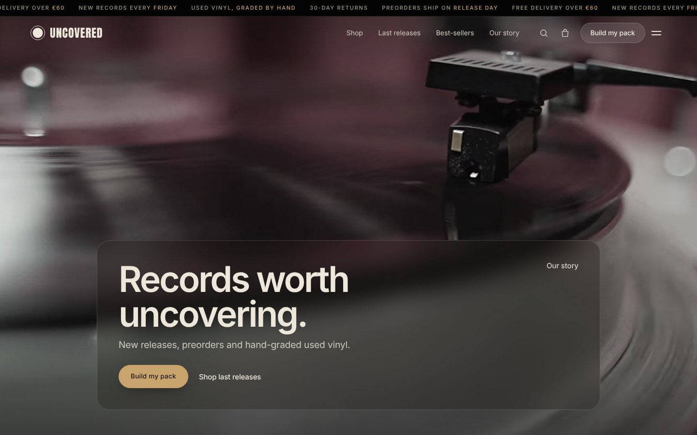<br><sub>**The hero.** Turntable footage under a frosted panel. The scrolling bar answers delivery, grading and returns before the first scroll.</sub> | 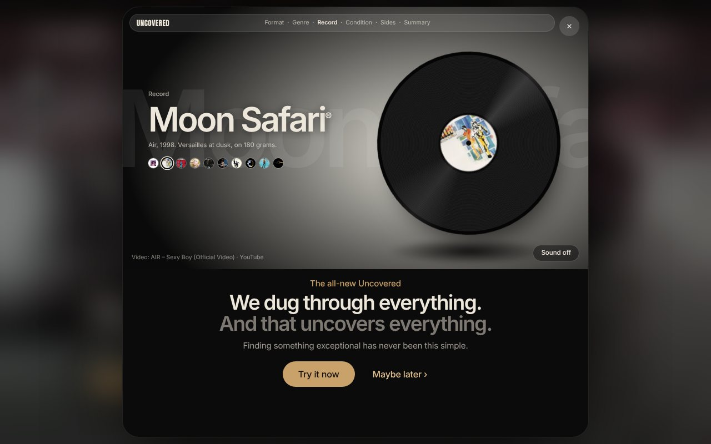<br><sub>**The opening popup.** A record finder on loop. Each record plays its official video behind it.</sub> |
| 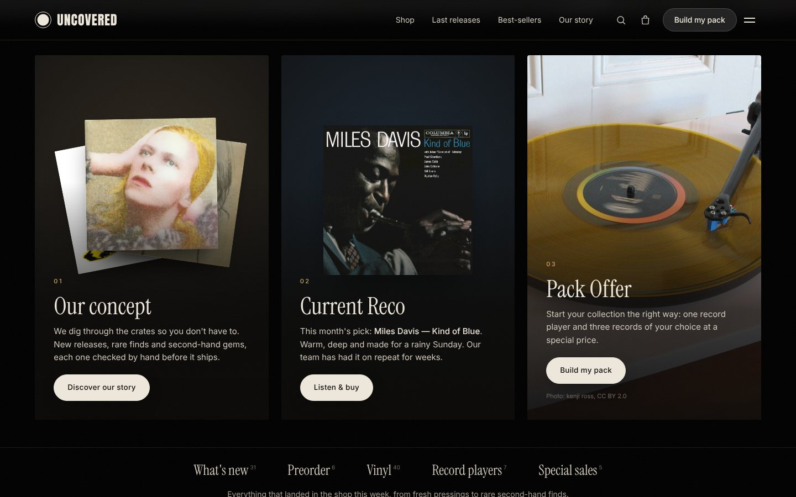<br><sub>**The banner.** Our concept, Current Reco and Pack Offer. On a phone it becomes a swipeable slider.</sub> | 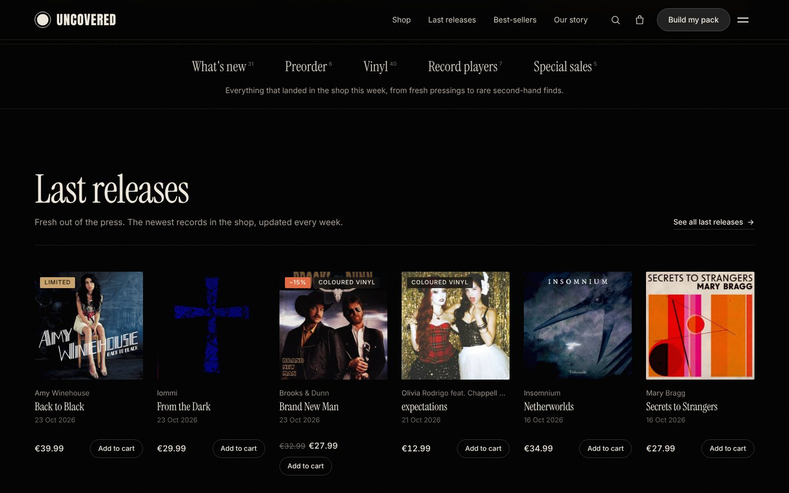<br><sub>**Main menu and Last releases.** Real autumn 2026 pressings, with release date, price and edition badges.</sub> |
| 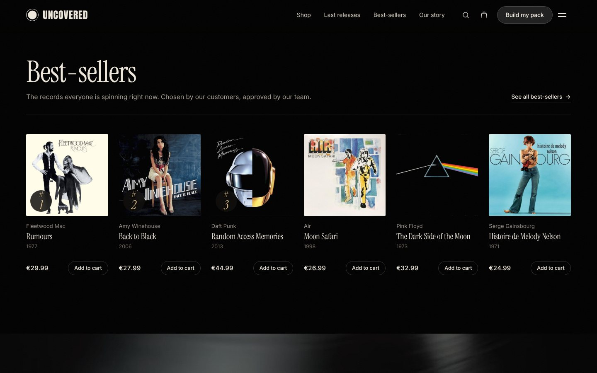<br><sub>**Best-sellers.** Ranked, so the shopper sees what others chose first.</sub> | 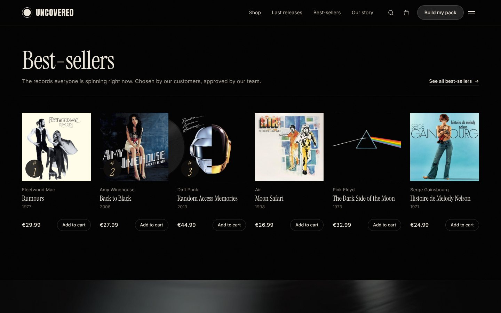<br><sub>**Out of the sleeve.** On hover, the record slides out, with the album art as its label.</sub> |
| 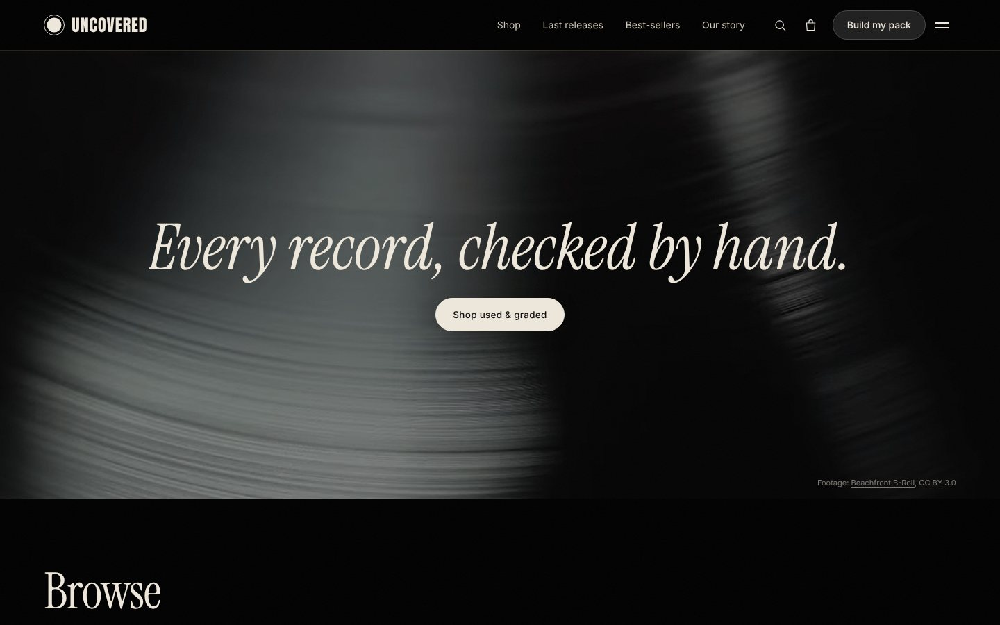<br><sub>**The promise.** A full-width video band: *Every record, checked by hand.*</sub> | 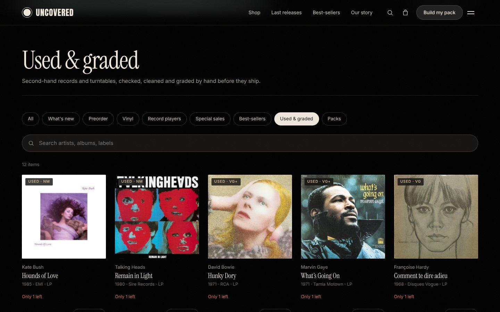<br><sub>**Browse.** The menu's categories in one grid, here filtered to *Used & graded*, with search.</sub> |
| 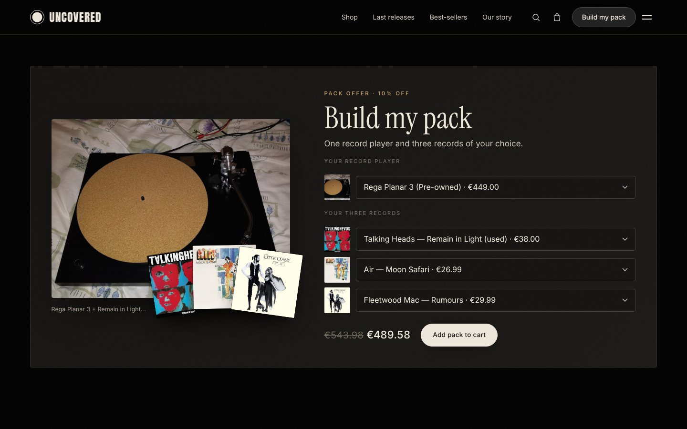<br><sub>**Build my pack.** The chosen turntable and records appear on the left, with the 10% saving in the price.</sub> | 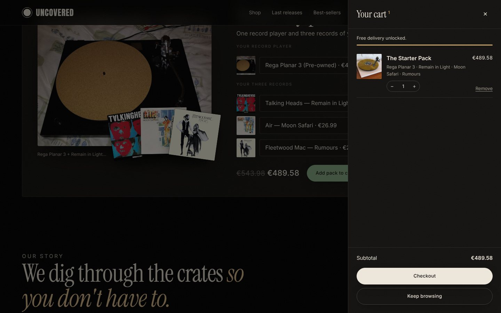<br><sub>**The cart.** A slide-out drawer with a free-delivery meter, so the shopper never leaves the page.</sub> |
| 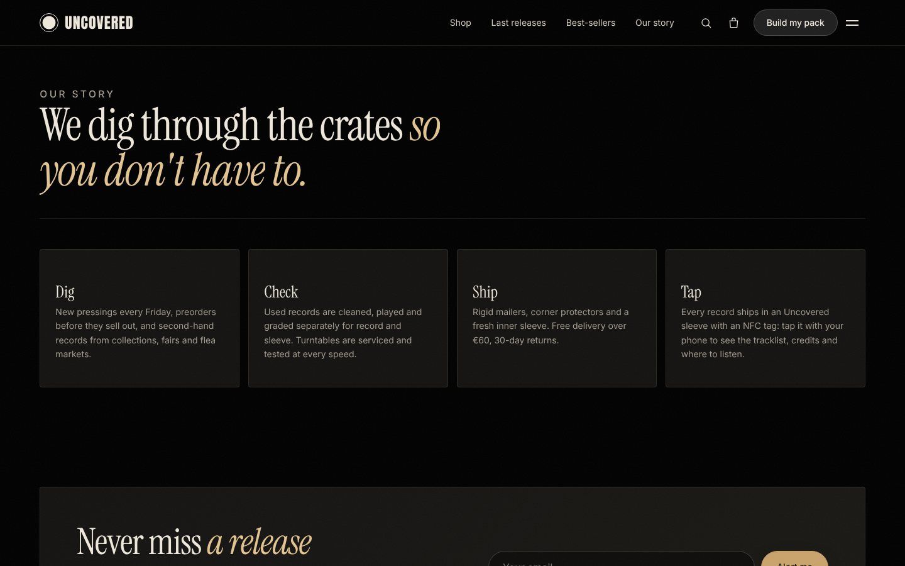<br><sub>**Our story and release alerts.** Dig, Check, Ship, Tap, then the Friday email.</sub> | 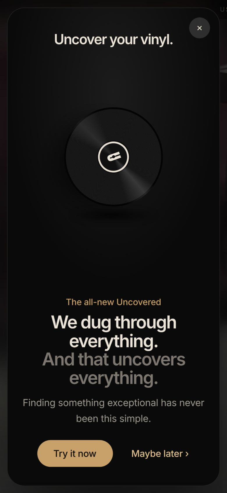 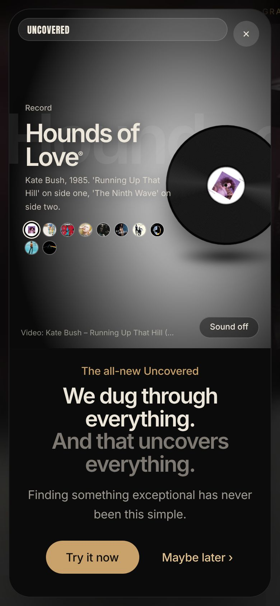 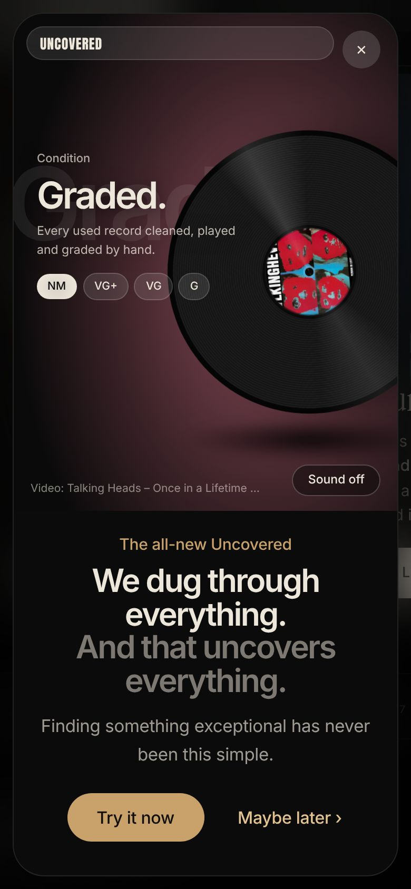<br><sub>**On a phone.** Every section is built to work on a phone.</sub> |

## Who it's for

- **The first-time buyer.** Has just discovered vinyl, maybe through a friend or a film, and wants a good turntable and three great records without a research project. Their job to be done: *"Get me started properly, without wasting money."* The Pack Offer and the plain-English guides are built for them.
- **The crate digger.** Already owns a deck and hunts for good pressings and clean second-hand copies. Their job to be done: *"Show me what's new and limited, and tell me honestly what condition it's in."* The two-part grading, release badges and Friday alerts are built for them.
- **The gift buyer.** Buys for someone else, so needs a safe choice. The Current Reco, best-seller ranks and 30-day returns help them pick with confidence.

## How we'd measure it

The site is the prototype. Measuring it needs real traffic, and every event below is already pushed to `window.dataLayer`, ready for GA4 through Google Tag Manager.

- **Primary: visit-to-order conversion**, step by step: product seen, `add_to_cart`, `begin_checkout`, order.
- **The opening.** The `opening_try_it` vs `opening_dismiss` rate. It tests whether the opening draws people in or gets in the way.
- **Listening sells.** `listen_extract` followed by `add_to_cart` for the same record. It tests whether a 30-second extract lifts conversion.
- **Bundles.** The pack's share of orders and its average order value, against single-record orders.
- **Retention.** `newsletter_signup` (release alerts) and repeat visits on release Fridays.
- **SEO and links.** Search Console impressions for the target questions in the [SEO plan](docs/SEO-PLAN.md), and referral traffic from each [netlinking partner](docs/NETLINKING.md).

## What we know, and what we're still assuming

| Confirmed | Still to validate |
|---|---|
| Every record is real. Tracklists, labels and release dates come from MusicBrainz, and covers from the Cover Art Archive. | Real demand and prices: what customers will pay for new, used and bundled records. |
| The *Last releases* and *Coming soon* rows match actual September–November 2026 vinyl releases. | Whether two-part grading measurably reduces returns of used records. |
| Every popup video is an official upload that its owner allows other sites to play, checked one by one. Blocked videos were replaced. | Whether the opening lifts conversion. That needs an A/B test with and without the popup. |
| The full journey works on the live site, on desktop and phone: browse, search, listen, build a pack, cart. | Search volumes for the SEO targets. These are still to pull from Keyword Planner. |
| | Which netlinking partners send buyers and not just traffic. |

## Our role

We wrote the blueprint (page hierarchy, three customer journeys, success measures), the wireframe and the copy for every section. We set the merchandising (Current Reco, Release of the week, best-seller ranks, edition badges), the bundle and its 10% discount, the €60 free-delivery threshold and the grading standard. We planned the content strategy for featured snippets and *People also ask*, and the netlinking partners.

We built the working site with AI coding tools, directing them from the brief instead of writing the code by hand. That's how a small team takes an idea from a document to a live, working shop.

## The marketing work

| Skill | Where it shows up |
|---|---|
| **Brand positioning** | *Records worth uncovering.* and *We dig through the crates so you don't have to.* carry from the tagline to the popup to *Our story* |
| **Information architecture** | Blueprint with three journeys (discovery and purchase, content access, support) and the five-door main menu |
| **Copywriting** | Page specs for every block, category intros, two-tone headlines, button copy (*Try it now*, *Maybe later*, *Build my pack*) |
| **Merchandising** | Current Reco, Release of the week, ranked best-sellers, Limited / Coloured / Signed badges, *Only 3 left* stock messages |
| **Pricing and bundles** | Pack Offer at 10% off with the saving shown live, sale prices with strike-through, free delivery from €60 |
| **Conversion design** | An opening that sells the feeling first, an in-page cart drawer with a free-delivery meter, a live pack preview |
| **Trust building** | Two-part grading (record and sleeve), 30-day returns, *Every record, checked by hand* |
| **Content and video** | Official artist videos in the popup, 30-second Deezer extracts, full-screen footage |
| **Lifecycle email** | *Never miss a release*: a weekly Friday alert for new arrivals, restocks and limited editions |
| **SEO** | [SEO plan](docs/SEO-PLAN.md): featured-snippet and *People also ask* targets, standard search snippets, technical SEO |
| **Netlinking** | [Partner plan](docs/NETLINKING.md): Paris Loves Vinyl, Disquaire Day, Discogs, FIP, vinyl creators and more, each with what we offer and what we get |
| **Measurement planning** | An event for each decision, ready for GA4 |

<sub>Brand files: [`docs/brand`](docs/brand) · Screens and the opening GIF: [`docs/media`](docs/media)</sub>

---

### For engineers

A single static page: HTML, CSS and vanilla JavaScript on Netlify, with no framework and no build step.

- **Real data, generated once.** `assets/js/catalog.js` holds 40 records and 7 turntables. MusicBrainz supplied the tracklists, labels, catalogue numbers and dates, and the Cover Art Archive supplied the covers.
- **The opening** (`assets/js/opening.js`) uses a CSS `clip-path` for the window-to-full-screen reveal. The popup's stage tints each scene from the album cover's average colour, read with a canvas.
- **Videos fail safe.** Popup videos are YouTube embeds driven through the IFrame API's `postMessage` events. A video is revealed only after it reports *playing*, and one blocked by its owner is removed quietly.
- **Real photos and footage.** Turntable photos come from Wikimedia Commons (CC BY / CC BY-SA, credited on the site). The hero and band footage is Beachfront B-Roll via the Internet Archive (CC BY 3.0), served as MP4 and WebM with poster frames.
- **Motion with care.** Lenis smooth scroll, scroll reveals and a speed-reactive marquee. Videos pause off screen, and everything respects *reduce motion*.

```bash
git clone https://github.com/prithwirajmukherjee15-cmd/UNCOVERED.git
cd UNCOVERED && python3 -m http.server 8000     # then open http://localhost:8000
```

To edit prices, stock, grades, ranks or the Release of the week, change `assets/js/catalog.js`. The popup's records and videos live in `VIDEOS` and `scenes` in `assets/js/opening.js`. After changing CSS or JS, bump the `?v=` number in `index.html`.

<p align="center"><sub>Made by <b>Prithwiraj Mukherjee</b></sub></p>
